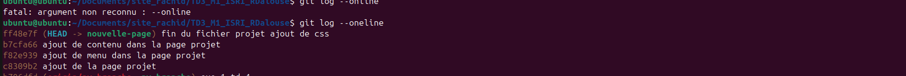
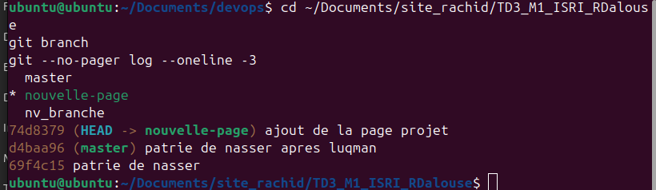
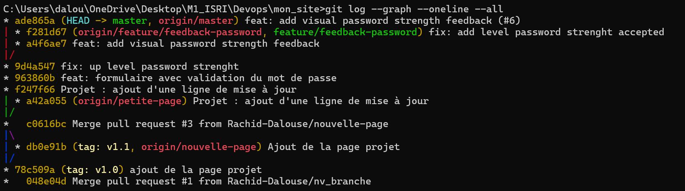

Hello World

## Historique après le squash

---

# TP 06 - Conflits, Rebase & Code Review

**Auteurs :** Nasser Salimou (Étudiant B, hotfix) et Rachid Dalouse (Étudiant A, feature)

**Dépôt :** https://github.com/Rachid-Dalouse/TD3_M1_ISRI_RDalouse (branche principale : `master`, qui joue le rôle de `main` dans l'énoncé)

## 1. Déroulement du TP

- **Étape 1 (A) :** création de `formulaire.html` (validation du mot de passe) et protection de `master` : pull request obligatoire, 1 approbation minimum, aucun contournement possible (même pour les admins).
- **Étape 2 (A et B en parallèle) :**
  - A crée `feature/feedback-password` avec 3 commits : `feat: add password strength feedback`, `wip: improve input password listener`, `style: visual password strength`.
  - B crée `hotfix/password-strength` depuis `master` : la regex exige maintenant un caractère spécial (`. & # - _`). Commit `fix: up level password strenght`, PR #5.
  - A fait la review (commentaire sur une ligne) et Approve ; B merge la PR #5 et supprime la branche distante.
- **Étape 3 (A) :** rebase de `feature/feedback-password` sur `origin/master`, conflit sur `formulaire.html` résolu en gardant le correctif de B et le feedback visuel de A, squash des 3 commits en `feat: add visual password strength feedback`, puis `git push --force-with-lease`.
- **Étape 4 :** PR #6. B vérifie (1 seul commit, correctif toujours présent) et fait Request changes. A ajoute le message indiquant le mot de passe accepté (`fix: add level password strenght accepted`). B fait Approve puis Squash and merge.

## 2. Graphe Git final

Commande : `git log --graph --oneline --all` (après `git fetch` et `git pull` sur `master`)

## 3. Questions

### Q1. Différence entre `git push --force` et `git push --force-with-lease` ? Pourquoi la seconde est-elle indispensable en équipe ?

`git push --force` remplace la branche distante par ma version locale sans rien vérifier : si un collègue a poussé des commits entre-temps, ils sont effacés.

`git push --force-with-lease` ne force que si la branche distante est encore dans l'état que j'ai vu à mon dernier fetch. Si quelqu'un a poussé depuis, le push est refusé et je dois d'abord récupérer son travail.

En équipe, c'est indispensable après un rebase ou un squash (l'historique est réécrit, donc un push forcé est nécessaire) pour ne jamais détruire le travail des autres sans le savoir.

### Q2. Pourquoi privilégier `git rebase` plutôt que `git merge` pour garder une branche de fonctionnalité à jour ?

Le rebase rejoue mes commits par-dessus la version à jour de la branche principale. On obtient un historique linéaire, sans commits de fusion « Merge branch main into feature » qui encombrent l'historique.

Les conflits sont résolus dans ma branche, avant la PR : la PR arrive propre et se fusionne sans conflit. L'historique est plus lisible pour la review et plus simple à exploiter (`git log`, `git bisect`, `git revert`).

Le merge garde l'historique réel mais ajoute un commit de fusion à chaque mise à jour. On ne rebase que sa propre branche, jamais une branche partagée comme `main`.

### Q3. Quel est l'intérêt d'imposer un squash des commits avant la fusion d'une PR dans un pipeline CI/CD ?

Le squash regroupe tous les commits d'une PR en un seul commit atomique par fonctionnalité sur `main`. Conséquences :

- historique de `main` lisible : un commit = une fonctionnalité ou un correctif ;
- revert ou cherry-pick faciles : on annule ou reprend toute la fonctionnalité d'un coup ;
- les commits intermédiaires (« wip ») qui ne compilent pas forcément disparaissent : chaque commit de `main` est stable, ce qui fiabilise la CI, `git bisect` et les déploiements ;
- la CI teste et déploie une unité cohérente, et le changelog est plus simple à générer.